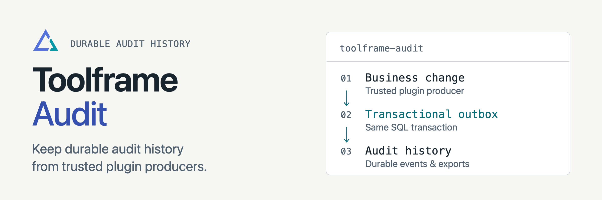

<p align="center">
<picture>
  <source media="(prefers-color-scheme: dark)" srcset="docs/assets/readme-banner-dark.png">
  <source media="(prefers-color-scheme: light)" srcset="docs/assets/readme-banner-light.png">
  
</picture>
</p>

# Toolframe Audit

[](https://github.com/toolframe/toolframe-audit/actions/workflows/ci.yml?query=branch%3Amain)

Keep durable event history from trusted Toolframe plugins.
Browse it in Dashboard, query a read-only MCP tool, or export JSONL pages.

## Quick start

In a running [Toolframe application](https://github.com/toolframe/toolframe-core#readme) with an active SQL provider:

```sh
toolframe --home APP plugin add pypi:toolframe-audit==0.2.1 --enable
```

```sh
toolframe --home APP plugin status audit --check
```

Use Python 3.14+ and SDK 0.4+. Grant `audit.read` to readers; retention operators
need `system.plugins.manage`. Follow the [outbox example](examples/outbox-producer/README.md)
to record business changes and pending audit events in one SQL transaction.

**Limits:** producers are trusted plugins; there is no client ingestion endpoint
or tamper-proof history. Capacity is bounded and retention is explicit. Configure
authentication before exposing audit data. SQLite is exercised with real stores;
PostgreSQL migration SQL is included, but live PostgreSQL needs separate validation.

## Guides

| I want to… | Start here |
| --- | --- |
| Record events from a plugin | [Producer integration](docs/producer-integration.md) |
| Query, export or prune history | [Usage](src/toolframe_audit/docs/usage.md) |
| Understand trust and capacity | [Architecture](docs/architecture.md) |
| Contribute or run checks | [Contributing](CONTRIBUTING.md) · [Verification](docs/verification.md) |
| Publish a package | [Releasing](docs/releasing.md) |

[Releases](https://github.com/toolframe/toolframe-audit/releases)

## License

[Apache 2.0](LICENSE).
